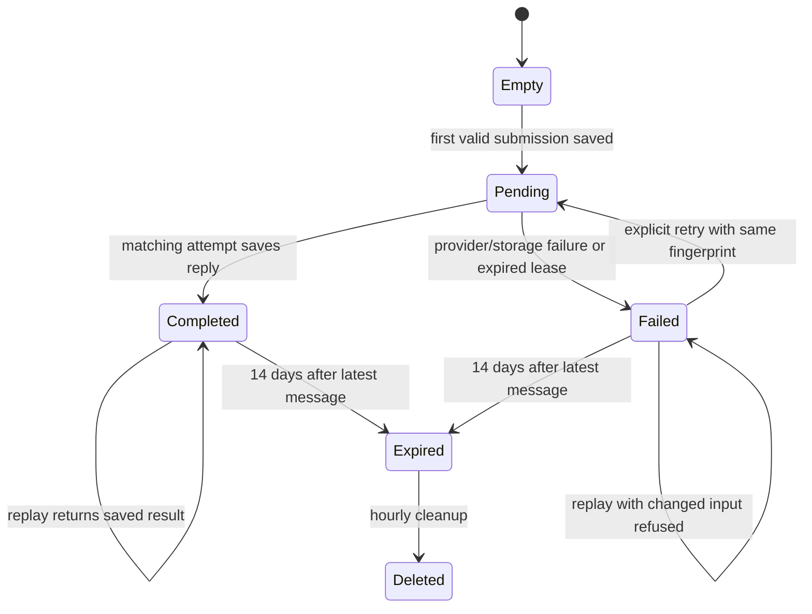

# Saved conversations design

**Updated** November 27, 2026\
**Designed against** `main` at `575ae20`, plus shared foundation `f2864e9`\
**Owners** Victor and DJ; Victor coordinates shared files.

## Realizes and depends on

Realizes `UC-CHAT-start-new-conversation` and `UC-CHAT-resume-conversation`; extends persistence for `UC-CHAT-work-through-problem` and `UC-CHAT-share-problem-image`. Governing qualities are `SEC-authentication`, `SEC-student-isolation`, and `ROB-external-service` in the specification. The [team guide](auth-chat-team-guide.md) owns integration interfaces.

The D1 schema and feature implementation are present. Real Supabase verification, the real AuthProvider, and the app-entry/baseline gate remain login-team integrations. The default Worker refuses saved-data requests until real handlers are composed. UI tests provide identities only in tests. Existing stateless Coach is the compatibility path when no AuthContext is mounted.

## Confirmed behavior

Victor confirmed: save a conversation on its first submitted message; retain failed user turns for Retry; save text and images; expire fourteen days after the last saved message; Gemma generates the title; discard unsent drafts on switching without confirmation; let generation finish in its original chat. On November 27 he accepted R2 with application usage limits and acknowledged that charges cannot be guaranteed zero. He confirmed R2 is currently dedicated to Neocortex.

Gemma title generation is a separate, best-effort request after the first successful reply. It uses a 64-token budget, reasoning disabled, an 80-character output bound, and a five-second timeout. Failure leaves the title “New chat” and does not fail the accepted reply. Its token usage uses the existing safe logging allowlist, with `purpose: title`.

Manual rename/delete, persistent unsent drafts, and instructor access to chat content are outside this increment.

## Components

| Component | Responsibility |
|---|---|
| `src/features/chat/conversationsApi.ts` | Current student bearer token per call; runtime DTO validation; authenticated binary image reads. |
| `useConversations.ts` | Lists, selection, per-chat state, stable IDs, recovery, pending polling, and clearing state on account changes. |
| `ConversationList.tsx`, `SavedCoach.tsx`, `chat.css` | Owned history, New chat, existing Thinking/Retry/Edit/image/Markdown/math presentation. |
| `backend/conversations/routes.ts` | Validates paths and bounded JSON bodies; receives the verified AuthUser from the app router. |
| `repository.ts` | Prepared owner/expiration-scoped D1 SQL, cursor pages, atomic turn reservation/finalization. |
| `service.ts` | Coordinates saved turns, image persistence, bounded server-loaded context, and Gemma. |
| `attachments.ts` | Validates image bytes, atomically reserves usage, and performs private R2 operations. |
| `cleanup.ts` | Bounded hourly expiration and durable image cleanup. |

## Main flow

```mermaid
sequenceDiagram
    actor S as Student
    participant UI as Saved Coach
    participant API as Worker with verified identity
    participant DB as D1
    participant R2 as Private R2
    participant AI as Gemma
    S->>UI: New chat (new-conversation step 3)
    UI->>UI: Clear draft; allocate no database record (steps 4–6)
    S->>UI: Submit first message (step 7)
    UI->>API: POST conversation ID plus first turn (step 8)
    API->>DB: Atomic conversation, pending turn, user text, image metadata
    opt Image attached
        API->>DB: Reserve upload budget atomically
        API->>R2: Save validated bytes before inference
    end
    API->>AI: Bounded stored context and server coaching policy (step 9)
    AI-->>API: Final reply
    API->>DB: Atomic accepted reply and completed status (step 10)
    API->>AI: Best-effort short title
    API-->>UI: Saved conversation and turn result
    UI-->>S: Render saved reply and history entry (step 11)
```



## API contract

All routes require a verified student from `requireUser` and any configured separate team header. No client owner ID is accepted. Missing and inaccessible IDs have the same 404 envelope. Errors use the shared JSON envelope and no-store caching.

| Route | Request and success | Failure/recovery |
|---|---|---|
| GET /api/conversations | Optional cursor; 20 owned summaries, nextCursor. | Invalid cursor 400; unavailable storage 503. |
| POST /api/conversations | `{ id, firstTurn: { clientTurnId, content, image? } }`; return `{ conversation, turn }`, 200 or 202 pending. | Invalid input 400/413/415; conflict 409; saved failed turn on model/storage failure. |
| GET /api/conversations/:id/messages | Optional cursor; latest 50 messages, chronological display; older cursor. | Inaccessible/expired 404. |
| POST /api/conversations/:id/turns | SendTurnRequest; TurnResult, 200 or 202. | Same completed input replays without inference; changed fingerprint/competing pending turn 409. |
| GET /api/conversations/:id/turns/:turnId | Saved TurnResult; recovery does not run Gemma. | Missing/foreign 404. |
| GET /api/conversations/:id/attachments/:attachmentId | Validated private image bytes; correct MIME, nosniff, private no-store. | Inaccessible 404; unavailable image 503; usage limit 429. |
| Hourly scheduled cleanup | Delete up to 200 expired conversations and process up to 100 image deletions. | Failed or uncertain deletions stay queued; future runs retry. |

**Coordinated contract correction:** The foundation's create request contained only an ID. It now includes `firstTurn`, so creation and first-message persistence share one transaction. The frontend no longer allocates a remote empty chat before sending its first message. The saved-data contracts changed together in shared types, routes, client validation, tests, and the team guide. AuthUser and requireUser contracts are unchanged.

## Data and concurrency

Migrations 0001/0002 establish owned conversations, turns, messages, attachments, expiration, and image_deletions. Migration 0003 adds a SHA-256 input fingerprint, persistent R2 usage/object reservations, and per-student daily counters. Existing rows without fingerprints cannot be silently retried with new content.

Fingerprint trimmed text and image data; filenames do not alter retry identity. Turn IDs are scoped to their conversation. The database permits only one pending turn per conversation. First creation, turn reservation, and user-message insertion run in a single D1 batch. Provider inference runs outside transactions. Reply insertion and completion run in a second batch with matching attempt ID, pending state, owner, and unexpired conversation conditions.

A pending attempt expires after two minutes. Reads and retries convert stale pending state to a safe failure. Explicit Retry receives a fresh attempt ID. A late completion from the prior attempt inserts no reply and cannot complete or fail the newer attempt. A replay of a completed turn returns stored messages; a replay still pending returns 202.

Only completed earlier user/assistant pairs plus the current user message enter inference. Failed/pending other turns do not create unmatched context. Apply existing 21-message, 12,000-character, and two-image context bounds before loading old image bytes. Display history remains independently paginated.

Conversation pages order by last activity and ID descending. Message pages order by turn ordinal and role; the returned page is chronological. All queries use prepared values and verified owner/expiration predicates.

Reading, changing a title, replaying an existing message, and retry status changes do not renew retention. A new saved user or assistant message renews expiration to its timestamp plus fourteen days. Access is refused immediately at expiration. Physical removal occurs on bounded hourly runs, and can lag expiration if cleanup is unavailable.

## Images and usage controls

Private image keys derive from the conversation ID, turn ID, and input hash. The browser retrieves bytes with its current bearer token and displays revocable blob URLs; tokens and public bucket URLs never appear in image sources. A failed upload keeps a retryable user turn but cannot claim the image was saved. After reloading such a failure, the original file may need to be attached again.

The R2 ledger reserves before every supported put/get, including reads for model context. It applies cumulative caps of 8,000,000,000 uploaded/reserved bytes, 800,000 Class A calls, and 8,000,000 Class B calls. These are conservative **lifetime application counters**, stricter than the monthly proposal: no automatic monthly reset and no refund after uncertain outcomes or deletion. Each verified student also has daily caps of 50 upload attempts and 500 image reads. Limits refuse image operations while text remains usable. A missing ledger or missing explicit storage opt-in refuses operations.

This choice avoids resetting budgets with uncertain in-flight requests or billing-period assumptions. It trades availability for conservative accounting: historical uploads eventually consume the application cap even after deletion. The owner can review/reconcile usage before a future reset policy is designed. Counts do not represent Cloudflare's complete account bill. Dashboard actions or future outside applications can add usage. R2 has no provider-enforced hard spending cap.

The configured bucket name is `neocortex-chat-images`. Live image operations remain disabled by configuration until the owner creates a fresh private Standard bucket, applies the migrations, and enables `CHAT_IMAGE_STORAGE_ENABLED`. This work performs no live object calls or production deployment.

Attachment cascades queue deletions. Cleanup deletes acknowledged stored objects before acknowledging their queue rows. Uncertain reserved uploads remain conservatively accounted and their deletion is retried, including possible late writes. Failed/uncertain queue entries rotate behind other work. The ledger is not refunded by cleanup.

The implementation uses R2 Standard. Cloudflare documents monthly Standard allowances of 10 GB-month storage, one million Class A and ten million Class B operations; DeleteObject is free. Those are provider allowances, distinct from the stricter application counters. [R2 pricing](https://developers.cloudflare.com/r2/pricing/), [Workers API](https://developers.cloudflare.com/r2/api/workers/workers-api-reference/).

## Test list and remaining integration

| Scenario / extension | Evidence |
|---|---|
| New first message, saved reply, generated title; resume + follow-up | routes.test.ts; SavedCoach.test.tsx. |
| Empty New chat and discarded draft (3a/3b, 7a) | SavedCoach.test.tsx. |
| Switch while generating (3c / resume 2a) | SavedCoach.test.tsx; original request remains active. |
| Save/model failure and Retry (8b/8c, resume 5a) | routes.test.ts; SavedCoach.test.tsx. |
| Lost response, replay, competing pending turn, expired attempt (10a / resume 5b) | routes.test.ts; frontend lost-response recovery test. |
| Other-owner/missing/expired IDs (resume 3b) | routes.test.ts; fabricated verified test identities. |
| Cursor pagination and bounded inference context (resume 3c) | routes.test.ts. |
| Private image round trip and retained-image follow-up (resume 4/4a) | routes.test.ts; frontend authenticated download/object-URL cleanup test. |
| Budget ceilings, concurrent last reservation, uncertain put, delete retry | routes.test.ts. |
| Title failure does not fail coaching; safe usage logs | routes.test.ts plus existing model tests. |
| Account change, expired session, late results (resume any-step) | SavedCoach.test.tsx. |
| Migration integrity and retention invariants | Existing schema.test.ts; local Wrangler migration application. |
| Real Supabase verifier/provider, two-real-account access, deployed R2, cron execution | Pending feature integration and deployed smoke tests; do not mark Verified. |
| Keyboard and responsive UI | Existing accessible controls plus Playwright inspection with fabricated preview data. |

The architecture's persistence paragraph now explicitly permits the two short chat transactions around external inference. Tests run production repository SQL on SQLite with a D1-shaped test adapter. Local Wrangler migration acceptance is an additional D1 check; these tests are not proof of a deployed authenticated service.

## References

- [Use cases](../requirements/use-cases.md).
- [Architecture](architectural-design.md), especially 8.1 and 8.2.8.
- [Database setup and live enablement](../database-setup.md).
- [D1 batch semantics](https://developers.cloudflare.com/d1/worker-api/d1-database/).
