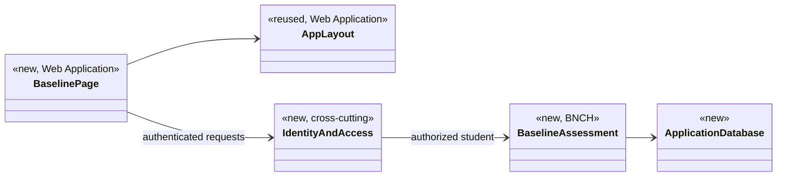

# Baseline Assessment Design

**Project:** Gen Chem Metacognition
**Team:** Team #4
**Area:** `UC-BNCH`

> **Realizes:** `UC-BNCH-complete-baseline-assessment`. No `FR-BNCH-*` requirement exists yet.
> **Depends on:** `FEAT-benchmark-quiz`; `SEC-authentication`; `SEC-student-isolation`; `ROB-invalid-data` (applied to this area by architecture-of-record section 6.2). The use case cites no business rules.
> **See:** [use cases](../requirements/use-cases.md#uc-bnch-complete-baseline-assessment-the-student-completes-a-baseline-assessment), [specification](../requirements/software-requirements-specification.md), [architecture-of-record](architectural-design.md)
> **Designed against:** `main` at `4257888`

---

_**How to use this template.** Copy it to `docs/design/<area>.md`, named for the lowercase area code (`ord.md` for `UC-ORD-*`). Instructions appear in italic square brackets; leave them in place until the document is stable, because the agent reads them on every later pass. The full worked example is Project Pulse's [`not.md`](https://github.com/Washingtonwei/project-pulse/blob/main/docs/design/not.md); read it for the shape, not for the answers._

_**What this document is.** The **design-of-record** for one use case area: how the code will realize its use cases, written **before** the code and approved before anyone builds from it. It is the last document your agent reads before it writes code, so anything it leaves out, the agent invents. Your [architecture-of-record](architectural-design.md) is the map of the whole system and stops at each component's responsibility; this document goes one level down, inside one area, against real code._

_**What it is not.** A copy of your use cases. It **cites** `UC-*`, `FR-*`, and `BR-*` by identifier and never restates what the system shall do; it says only how. It is also not a transcript of the code. Once code exists, link to the files rather than describing every class, column, or getter._

_**One document per area, not per use case.** Your area gains use cases over the term. The overview, the class diagram, and the data model are **revised in place** when it does. The sequence diagrams, the API contract rows, and the test rows are **appended**, one set per use case. Never add a `## UC-…` section that repeats the whole skeleton._

_**How much to write.** Pin down what a wrong guess would break: a requirement, a business rule, a quality attribute, or the contract between two parts of your team. Leave the rest for the agent to derive while it builds: variable names, field types, exact JSON, column lengths. When you are unsure, ask which side of that line a detail falls on, not whether it is interesting._

_**Write it in this order.** Each step is one person's or one pair's work, and the order is the point:_

1. _**Sketch it yourselves first.** Before you open the agent, draw the main success scenario's sequence diagram and write the API contract rows by hand, from the use case and your architecture-of-record. Twenty minutes, on paper or in this file._
2. _**Have the agent draft it.** Give the agent this template, the use case, the business rules it cites, your architecture-of-record's section 8 (Crosscutting Concepts), and the relevant existing code, and ask for a draft of this document. Use plan mode, so it proposes before it writes._
3. _**Compare the two.** Where the agent's draft differs from your sketch, decide which is right and why. What it found that you missed goes in; what you knew that it could not have known is the context your specification is missing, so fix the specification too._
4. _**Run the questions test** (the last section) and fix what it finds._
5. _**Open a pull request.** A teammate who did not write it reviews and approves it. Nobody starts an implementation branch from this design until it is merged._

---

## Overview

_[One paragraph: what this area does, which components of your [architecture-of-record](architectural-design.md) it lives in, and what it reads from or calls in other areas. Link the container diagram rather than redrawing it. If this design changes the architecture-of-record, say so here and list the change under "Changes to the architecture-of-record" below.]_

The baseline assessment records a student's current study habits and preferences in a short initial survey (`FEAT-benchmark-quiz`), so the system has a starting point for that student. It is the `BNCH` area of the Application API: the **Baseline assessment** component ([containers](architectural-design.md#51-containers), [use case areas and components](architectural-design.md#52-use-case-areas-and-components)). It gets the caller's identity from **Identity and access** and stores responses and completion state in the Application Database. The **Coach and model gateway** later reads the student's baseline responses, because the Language Model Service receives them with each coaching request (architecture-of-record 8.1, Sensitive data). On `main`, the Web Application has no baseline page yet (its routes are `/dashboard`, `/study`, `/coach`, and `/progress`), and the Application API and Application Database are not built (architecture-of-record 5.1). This design does not change the architecture-of-record.

## Components & classes

_[One class diagram for the whole area, and one line per class or file saying what it does and whether it is **new** or **reused**. Show only what a reader needs to see how the parts relate: classes, their key methods, their dependencies. Fields and getters belong to the code._

_**If your repository has no code for this area yet**, which is the normal case for your proving slice, list the files you expect the agent to create, with the paths your architecture-of-record's conventions give them, and mark them all new. The agent then builds into the structure you chose rather than one it improvised.]_

No code exists for this area. The Application API's package layout and framework are not yet fixed (section 5.2 lists the server technology as TBD, and 8.2.4 names Python), so the parts below are named by responsibility. File names are left for the team to choose under these conventions.



- **Baseline page** (new): a page under `gen-chem-mc/src/pages/`, the folder the project README assigns to page-specific code. It shows the explanation and questions, collects answers, lets the student review before submitting, and shows the per-question errors and retry message the API returns.
- **`AppLayout` and `PageHeader`** (reused): the shared shell in `gen-chem-mc/src/components/`. The project README says to reuse it rather than duplicate sidebar or header markup.
- **Identity and access** (new, cross-cutting): authenticates the caller and scopes the request to that student (architecture-of-record 5.2, 8.1). It is shared with every area, not owned by `BNCH`.
- **Baseline assessment** (new): owns the assessment questions, response validation, the association with the student, and completion state (architecture-of-record 5.2).
- **Application Database** (new): PostgreSQL on Supabase (architecture-of-record 5.1).

## Sequence

_[One sequence diagram per use case for its main success scenario, plus one for each extension that does not just return an error. **Label each interaction with the use case step it implements**, so a reviewer can check that every step is realized and nothing extra was invented. Use `alt` blocks for extensions that branch off the main flow. Give each use case its own `###` heading; that heading is the anchor your traceability matrix cites.]_

### UC-BNCH-complete-baseline-assessment: completing the baseline assessment

Steps 3 to 8 happen in the Web Application and responses are sent once, at submission, as in architecture-of-record 6.2. Whether step 6 ("records the response") must also save each answer on the server is open (see Open questions).

```mermaid
sequenceDiagram
    actor S as Student
    participant WEB as Web Application
    participant ID as Identity and access
    participant BA as Baseline assessment
    participant DB as Application Database
    S->>WEB: Begin the assessment (step 1)
    WEB->>ID: Request the assessment questions
    ID->>BA: Authorized student
    BA-->>WEB: Explanation and questions (step 2)
    S->>WEB: Begin, answer each question (steps 3 to 7)
    WEB-->>S: Completed assessment for review (step 8)
    S->>WEB: Submit (step 9)
    WEB->>ID: Submit responses
    ID->>BA: Responses for the authorized student
    BA->>BA: Validate required responses (step 10)
    alt a required response is missing (10a)
        BA-->>WEB: Errors naming the unanswered questions (10a1)
        WEB-->>S: Ask for the missing responses; rejoin at step 10 (10a2, 10a3)
    else all required responses present
        BA->>DB: Store responses and completion state in one transaction (step 11)
        alt the save fails (11a)
            DB-->>BA: Failure
            BA-->>WEB: Save error; nothing marked complete (11a1)
            WEB-->>S: Could not save; entered responses kept for a retry (11a1, 11a2)
        else saved
            DB-->>BA: Saved
            BA-->>WEB: Completed
            WEB-->>S: Confirm completion (step 11)
        end
    end
```

## API contract

_[One row per endpoint, scheduled job, or message this area adds or changes, appended per use case. **This section is never dropped**: before the code exists it is the only thing the person (or agent session) building the front end and the one building the back end both read. Name the caller and who may call it, the request fields, the success response, and the error each extension returns. Leave field types and exact JSON to the agent unless a wrong guess would break something, such as a format another system depends on. Use the error shape your architecture-of-record's section 8.2 fixes; do not invent one here.]_

The URL prefix (8.2.3) and the error shape (8.2.1) are required by the architecture-of-record but not yet defined there, so the operations below have no paths or status codes yet.

| Operation | Caller (who may) | Request | Success | Errors, by extension |
|---|---|---|---|---|
| Get the assessment (step 2) | A signed-in student; identity from the Supabase session, never from the request (8.1) | None | The explanation and the questions, marking which are required | Not signed in: refused (`SEC-authentication`). |
| Submit responses (steps 9 to 11) | A signed-in student, for themselves only; identity from the session, never from the request (8.1) | A response for each question | Completion confirmed | 10a: validation error naming each unanswered required question, nothing stored. 11a: save error, nothing stored and not marked complete. Not signed in: refused (`SEC-authentication`). |

## Key decisions

_[Only the decisions a reader could not recover from the code: an invariant, who may do this and how it is enforced, a trade-off you chose, a reason you reused something rather than writing it. **Each one names what you chose, what you rejected, and why.** If you cannot name an alternative you considered, it probably was not a decision; leave it out._

_A decision that affects the whole system rather than this area is an architecture decision. It belongs in your architecture-of-record as a `KD-*` entry, not here.]_

**When the assessment is marked complete.** In the same transaction that stores the validated responses (architecture-of-record 6.2, 8.2.8). Rejected: storing responses and setting completion in separate steps, because a failure between them could mark a student complete without their responses, which `UC-BNCH-complete-baseline-assessment` forbids (POST-2, extension 11a, and the completion-status rule in its Associated Information).

## Data model

_[The **change** this area makes to the data: new tables or entities, new columns, the migration that adds them. Draw an ER diagram when there is more than one new table. Do not redraw the domain model; your [specification](../requirements/software-requirements-specification.md) owns it, so link it and show only the change. If the area changes nothing, say "No change" and give the reason in one line; that is a design decision too.]_

The specification's domain model (section 7.1) still holds only the template example, so this lists what the area must store rather than tables:

- **Baseline responses**, each belonging to one student: a selection or text, required for required questions, visible only to that student and authorized system functions (use case, Associated Information).
- **Completion state** for each student: set only after all required responses are stored (use case, Associated Information).
- Each record carries its owning student and its created and last-changed times, in UTC (architecture-of-record 8.2.9, 8.2.2).

Not yet decided, and changing the model: whether the questions themselves are stored in the database, and whether retakes keep earlier responses (see Open questions).

## Reuse & cross-cutting

_[Which existing services, components, and conventions this area uses rather than rebuilding: authentication, the error handler, email, the clock, another area's service. Cite your architecture-of-record's section 8.2 for each convention by name rather than restating it.]_

- **Authentication and authorization**: Identity and access with Supabase Auth (8.1). The instructor never sees baseline response content (8.1, Authorization).
- **Error handling**: one error shape from one place (8.2.1).
- **API conventions**: one URL prefix, JSON responses (8.2.3).
- **Validation**: the Application API's check is the one that counts; any check in the Baseline page is a convenience (8.2.5).
- **Logging**: never log baseline response content (8.2.7).
- **Persistence**: one transaction per submission (8.2.8).
- **Auditing**: owner and timestamps on every record (8.2.9).
- **Time**: the Application API's clock, stored in UTC (8.2.2).
- **Configuration and secrets**: environment variables, never in the repository (8.2.6).
- **Testing**: made-up student data only (8.2.10).
- **Web Application shell**: `AppLayout` and `PageHeader` (project README, Development guidelines).

## Tests

_[One row per flow: the main success scenario and **every** extension of every use case this document realizes, appended per use case. Name the level (unit or integration) and what the test asserts. No code. This list is the definition of done that the reviewer approves; the agent writes these tests when it builds, and a reviewer can see at a glance whether an extension has no test.]_

| Use case, flow | Level | Asserts |
|---|---|---|
| UC-BNCH-complete-baseline-assessment main | unit (Application API) | Complete, valid responses are stored for the signed-in student and the assessment is marked complete |
| UC-BNCH-complete-baseline-assessment 10a | unit (Application API) | A missing required response is rejected with errors naming each unanswered question, and nothing is stored |
| UC-BNCH-complete-baseline-assessment 10a | component (Web Application) | The Baseline page shows which questions to complete and keeps the answers already given |
| UC-BNCH-complete-baseline-assessment 11a | unit (Application API) | When the save fails, no responses are stored and the assessment is not marked complete |
| UC-BNCH-complete-baseline-assessment 11a | component (Web Application) | The Baseline page shows the save error and keeps the entered responses for a retry |
| Authentication | unit (Application API) | A request without a valid session is refused and returns no assessment data (`SEC-authentication`) |
| Student isolation | unit (Application API) | Responses are stored for, and read back only by, the student in the session; a student identifier in the request is ignored (`SEC-student-isolation`) |
| Logging | unit (Application API) | No log entry written during a submission contains response content (8.2.7) |

## Changes to the architecture-of-record

_[Designing an area against real code is when the architecture's guesses meet reality. If this design needs a component the map does not have, moves a responsibility, or adds a dependency, **change [the architecture-of-record](architectural-design.md) in the same pull request** and list each change here in one line. If nothing changed, write "None". A design that silently disagrees with the architecture leaves two maps, and the agent will follow whichever it reads last.]_

None.

## Open questions & risks

_[What this design could not settle and who can, and what could go wrong that you are accepting. A question for the client also goes in [`OPEN-ISSUES.md`](../requirements/OPEN-ISSUES.md).]_

**For the client** (also to add to `OPEN-ISSUES.md`, which has no entries yet):

- Is completing the assessment mandatory? (use case, Open Issues)
- Can students retake it, and if so, are earlier responses kept? This changes the data model and the API. (use case, Open Issues and Frequency of Use)
- What are the exact questions and answer options? `FEAT-benchmark-quiz` names preferred time of day, session length, and methods; the use case also mentions print versus digital study and office-hours use; which study methods to list is open (`OI-STUDY-METHODS`).
- Must students sign in at all (`OI-ANONYMITY`, `OI-PRIVACY`)? Anonymous use would change how responses are associated with a student. Sign-in in 8.1 is provisional.
- How long are baseline responses kept, and when are they deleted (`OI-PRIVACY`; specification 7.4 is empty)?

**For the team:**

- Does step 6 ("records the response") mean saving each answer on the server as the student goes, or holding answers in the Web Application until submission, as architecture-of-record 6.2 shows?
- Where do the questions live: in the database or in code?
- How does the Web Application keep entered responses for a retry after a failed save (architecture-of-record 6.2 leaves the client-storage mechanism open)?
- Define the URL prefix (8.2.3) and the error shape (8.2.1) before the API contract rows can name paths and status codes.
- Settle the Application API's server technology: section 5.2 says TBD while 8.2.4 says Python, and the chatbot prototypes on unmerged branches run as TypeScript Cloudflare Workers.
- The use case cites the glossary terms "Study habits" and "Baseline assessment", but the project glossary does not define them yet.

**Risks accepted:**

- Students may guess or answer dishonestly, so self-reported habits may not match logged behavior (`RI-benchmark-survey-noise`). The vision's mitigation is a short assessment of about 5 questions, compared with the first two weeks of logged sessions.
- Baseline responses are identifiable student data (`RI-privacy-exposure`) and are also sent to the Language Model Service (architecture-of-record 8.1).

---

## Working this document with your agent

_[Delegate: drafting the diagrams from your sketch and the use case; listing the existing files a class should extend; filling the contract rows' request and response fields; proposing the test row for each extension; drafting the rejected alternative for a decision you have already made; checking that every identifier this document cites exists in the document that owns it._

_Keep human: which side of the "would a wrong guess break something" line each detail falls on; every key decision; and the approval, which is a teammate's review of the pull request, not the drafter's own reading._

_**The specific failure to watch for: scope that nobody asked for.** An agent drafting a design adds what designs it has read usually have: an admin override, a retry queue, a status field, a notification "while we are here". Each looks reasonable and none is in your use case, and once it is in the design the agent will build it, test it, and you will maintain it. Read the sequence labels: every interaction should name the use case step it implements. An interaction with no step is either a missing requirement, which goes to your specification and your client, or scope creep, which comes out.]_

---

## The questions test (before you open the pull request)

_[Start a **fresh** agent session in plan mode, so it carries nothing from the session that drafted this document. Give it only the use case, the business rules it cites, your architecture-of-record's section 8, and this document, and ask:_

> _List every point you would still have to guess to implement `<UC-ID>`. For each, say what you would guess and whether a wrong guess could violate a requirement. Do not write code._

_For each item on its list, either fix this document or keep the guess and write one line saying why a wrong guess breaks no requirement. Paste the list, with your answer to each item, into the pull request description under How it was verified, inside a collapsed `<details><summary>Questions test</summary> … </details>` block so the description stays short. The design is ready when nothing on the list could break a requirement.]_
