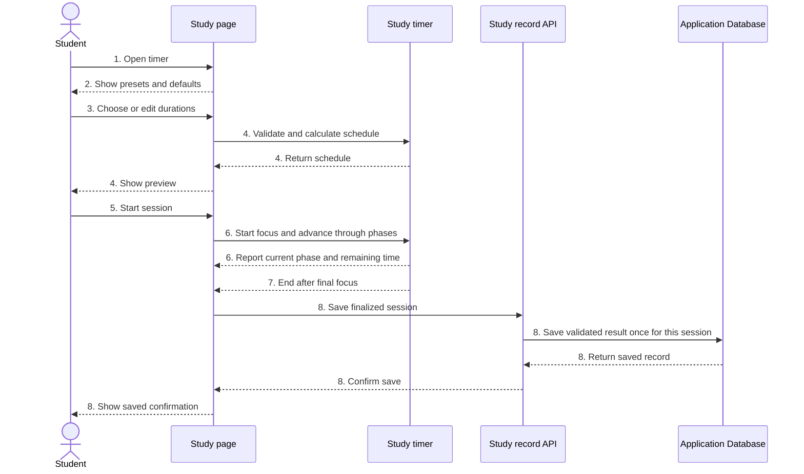
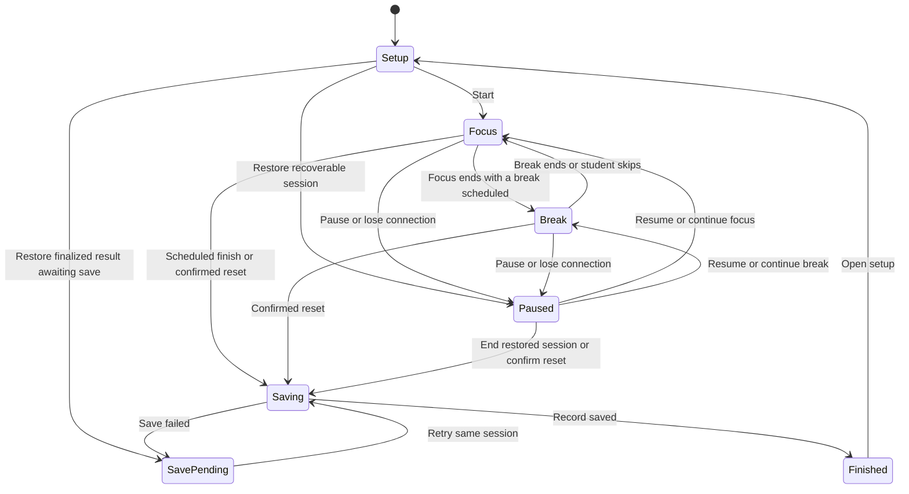

# Study Timer Design

**Realizes:** [`UC-STDY-use-pomodoro-timer`](../requirements/use-cases.md#uc-stdy-use-pomodoro-timer-run-a-timed-study-session), under `FEAT-pomodoro-timer`.  
**Depends on:** `FEAT-study-session-log`, `USE-core-navigation`, `ROB-study-session`, `ROB-invalid-data`, `PER-study-log`, `SEC-authentication`, and `SEC-student-isolation`.  
**Designed against:** `FEAT-pomodoro-timer` at `fba73de`.

## Overview

Timer behavior comes from Team 4's November 20, 2026 design discussion. The use case records the agreed behavior. The components, storage approach, and API contract below are proposed implementation decisions. Alerts and editable duration limits are open.

The timer lets a student choose how much time they have to study, see how that time is divided, and run the session. The current [Study page](../../gen-chem-mc/src/pages/Study.tsx) contains a page header. [App](../../gen-chem-mc/src/App.tsx) already mounts it at `/study`, and [AppLayout](../../gen-chem-mc/src/components/AppLayout.tsx) provides Study navigation. The [architecture-of-record](architectural-design.md#52-use-case-areas-and-components) identifies Study record as a provisional Application API component. This design uses that component for durable study records.

## Components & classes

| Responsibility | Component |
|---|---|
| Duration inputs, presets, schedule preview, timer controls, and recovery choices | Timer feature on the existing Study page |
| Schedule calculation, phase advancement, and allocation of active time | Study timer logic shared by the preview and countdown |
| Restore the active session and preserve completion awaiting save | Browser recovery data, scoped to the student and session |
| Validate and store the finalized study session | Study record in the Application API and the Application Database |

## Sequence

## State transitions

Manual pause offers Resume. A recovered pause offers Continue session and End session. Reset confirmation is a prompt within the current timer state. Canceling it leaves that state in effect.

## API contract

The Web Application calls this operation with the signed-in student's session. Architecture sections 8.1 and 8.2 specify ownership and validation. The shared URL prefix and error fields still need to be defined by the Application API.

| Operation | Caller (who may) | Request | Success | Errors |
|---|---|---|---|---|
| Record timed study session (step 8) | Study page for the signed-in owner. Derive ownership from the authenticated session. | Stable session ID, Pomodoro method, and finalized total, focus, and break durations | Saved record or confirmation of the same record on a retry | Missing credentials or unauthorized access is refused. Invalid totals are rejected. A repeated session ID with different finalized totals is rejected without changing the stored record. Save failure leaves the finalized result available to retry (8a). |

## Key decisions

- **Share one schedule between preview and timer.** The saved plan defines one ordered timeline with each instant assigned to a single period. Per-period counters that run independently of the preview could disagree at a boundary.
- **Keep the selected total through a skip.** Reclassify the unspent portion of the current break as focus and begin focus immediately. For the proposed countdown, combine contiguous focus time through the next scheduled break or session end. Later scheduled boundaries retain their original session offsets. The modified schedule is part of recovery data. Discarding the skipped minutes would shorten the session.
- **Freeze accrued time before resuming.** Preserve the phase and elapsed session position across pause and recovery. Resuming a continuously running countdown after an interruption could count time the student did not spend in the session.
- **Finalize once per session.** Freeze the accrued totals on completion or explicit end and use the same session ID and totals for every save attempt. Enforce uniqueness on the authenticated owner and session ID in the save transaction. A new ID on retry could produce duplicate study records.

## Data model

- **Active session recovery data** holds the owner and session identifiers, selected schedule, current position, and accrued focus and break times. It also retains frozen totals for a save awaiting retry. The recovery mechanism must survive refresh and tab or browser closure.
- **Study session record** holds the owner, stable session identity, Pomodoro method, actual total, focus, and break durations, and the timestamps required by architecture sections 8.2.2 and 8.2.9. This is one logical record for `FEAT-study-session-log`. The shared study record design still needs to settle the time-of-day field and endpoint details.

## Reuse & cross-cutting

Reuse Study navigation and `PageHeader`. Apply the Application API's identity and ownership checks (8.1), error and validation conventions (8.2.1, 8.2.3, 8.2.5), server-owned record timestamps (8.2.2), and transaction and test conventions (8.2.8–8.2.10). The browser measures progress for the visible countdown. Durable record timestamps come from the Application API. Session time excludes all time spent paused. Use a controllable clock for timer and recovery tests. Measure recovery error as the difference between expected accrued session time at interruption and accrued time first shown after recovery, including interruptions near phase boundaries.

## Tests

| Use-case flow | Level | Acceptance check |
|---|---|---|
| Main, 1–5 | Component | Study navigation reaches the timer within three clicks. All four presets are offered. Editing total, focus, or break updates the preview. Start uses the previewed schedule. |
| Main, 6–8 | Unit and integration | Focus and break advance automatically. The timer completes in focus at the selected total. One record shows actual total, focus, and break time and appears in study history within two seconds of successful save. |
| Schedule boundaries, 4 and 7 | Unit | For 25/5 settings, 25 minutes is one focus period. At 45 minutes the periods are 25 focus, 5 break, and 15 focus. At 56 and 60 minutes the last focus is 26 and 30 minutes respectively. At 61 minutes the periods are 25 focus, 5 break, 25 focus, 5 break, and 1 focus. Periods never overlap and always sum to the total. |
| 2a | Browser integration | Refresh restores paused within the `ROB-study-session` tolerance. Reopening in the same browser offers Continue and End on the recovered session. Continue uses the restored position. End saves the accrued totals once. |
| 2b | Browser integration | Reload after a save failure. The student can retry the same frozen result, and the countdown cannot resume. |
| 4a | Component and API unit | Incomplete or invalid inputs identify the affected field and prevent the student from starting the session. Invalid or inconsistent totals submitted to the API cannot create a study record. |
| 6a | Unit | Skip two minutes into a five-minute break. Two minutes remain classified as break and three become focus. Focus starts immediately and the total stays fixed. Refresh after skipping and verify that the modified phase and accrued times survive. |
| 6b | Unit and component | Pause 15 minutes into the first focus of a 60-minute session. Advance wall time, then resume with 45 minutes of session time remaining and 15 focus minutes accrued. |
| 6c | Browser integration | Lose and restore the connection during focus and during break. The session pauses, retains its phase within the required tolerance, and waits for Continue or End. |
| 6d | Component and integration | Cancel leaves the timer in its prior state. Confirm stops the timer and saves the accrued total, focus, and break times, including when reset during a break, while paused, or before any time accrues. |
| 8a | Integration | Simulate a failed save and a lost response after a successful save. Retrying the same finalized session records it once and leaves accrued values unchanged. Sending different totals for the same saved session ID cannot overwrite the record. |
| Authentication and isolation | API unit | A request without authorization or for another student's session cannot create or retrieve that student's record. |

## Changes to the architecture-of-record

None. The proposed persistence uses the existing Study record boundary.

## Open questions & risks

- `OI-TIMER-DURATION-LIMITS` determines the valid input range and increments. `OI-TIMER-ALERTS` determines whether to add phase or completion alerts.
- The shared study log design needs to define the contract owner and the representation of session time of day, especially if a session ends offline and saves later.
- Multiple tabs can access the same recovery data. Decide which tab controls a shared active timer and how the other tabs behave. Specify what happens when the student navigates away from Study or the browser suspends the tab, so the page lifecycle cannot silently change accrued time.
- Validate browser recovery against actual tab close and reload behavior. Preserve enough progress to meet the existing refresh and temporary connection-loss tolerance, and verify the restore cutoff for an interrupted session before implementation is considered ready.
